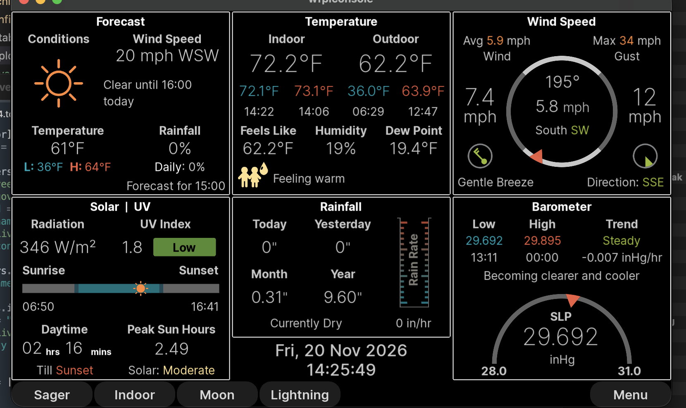

# WeatherFlow Home Console Developer Notes

## What this fork adds

Pete Davis’s WeatherFlow PiConsole displays observations from a Tempest or Smart Home Weather Station. It already supports local UDP, WeatherFlow cloud services, and custom display panels. WeatherFlow Home Console uses that existing panel interface to show readings from indoor sensors in multiple rooms alongside the station’s weather.

The collector writes readings to SQLite. The Indoor Climate panel shows each configured sensor’s temperature, humidity, battery (when available), and last-seen time. The built-in Temperature panel can also follow the configured `indoor` binding for its current value and daily extrema. WeatherFlow AIR remains the default. The H5074 has been tested on macOS. Mock providers support hardware-free development, and Nest SDM is a scaffold.



On the Mac Studio, the built-in panel showed **72.2°F indoors**, a low of **72.1°F at 14:22**, and a high of **73.1°F at 14:06**. The outdoor Tempest reading was **62.2°F**. The times follow the station timezone and console time format.

## Prepare the development environment

Use the mock smoke test and offline suite in the [platform setup guide](../setup.md#development-and-acceptance-tests). For source-selection diagnostics, run the collector and reader separately as shown below.

## Smoke-test the mock collector

Use a development account or a disposable copy of the example configuration with its database path changed if you already collect real telemetry. The example used the default database at `~/.local/share/home-telemetry/telemetry.db` in the Mac test. Keep the collector and display pointed at the same database when testing the panel.

In **Terminal 1**, activate the virtual environment and start the collector. Leave it running.

```bash
python -m home_telemetry --config deploy/home-telemetry.toml.example run
```

In **Terminal 2**, open the same repository, activate the virtual environment, and inspect the running collector.

```bash
python -m home_telemetry --config deploy/home-telemetry.toml.example status
python -m home_telemetry --config deploy/home-telemetry.toml.example selection explain indoor
python -m home_telemetry --config deploy/home-telemetry.toml.example selection explain upstairs_humidity
```

Expect `Collector: running`, three healthy and fresh mock providers, and `Selected: demo-main` for `indoor`. The upstairs binding should select `demo-upstairs`. The Govee and Nest entries should remain disabled. If the output says `stale`, check Terminal 1 and compare the last-observation timestamps in successive `status` calls.

## Open the desktop display

Use the wizard to install the desktop packages and custom panel. For a live station, follow the [station INI guide](configuration-setup.md#how-piconsole-creates-and-populates-the-ini).

Keep Terminal 1 running the collector. In Terminal 2 on Windows or Linux, launch the display with `python main.py`. On macOS, use this launch command if Retina scaling makes labels overlap.

```bash
KIVY_METRICS_DENSITY=1 KIVY_METRICS_FONTSCALE=1 python main.py
```

1. Confirm the regular weather panels show your station data and a recent observation.
2. Open **Menu → Settings → Secondary Panels**. Choose an unused slot, such as Panel Two, and scroll the selector to `IndoorClimate`.
3. Close Settings and click the **Indoor Climate** button on the main display. The panel should show fresh mock readings with temperature, humidity, battery, and last-seen time. Scroll inside the panel to see the remaining rooms.

If `IndoorClimate` is missing from the selector, verify both deployed files are in `user/` and restart PiConsole. If it appears but shows stale readings, check the collector and confirm that both processes use the same database path.

## Switch from the mock demo to a real sensor

Exit the demo display and stop its collector. Follow the [H5074 setup](providers/govee.md) to install Bluetooth support, discover the advertised name, and create the live configuration. On macOS, follow the [one-command launch](deployment.md#macos) to run both processes. Open the Temperature panel and compare the Indoor column with the screenshot above. Use the custom Indoor Climate panel to check source, freshness, and battery.

## Finish the test

Close PiConsole and press **Control-C** in the collector terminal. SQLite data remains on disk for the next run. Check `git status --short` before committing. Provider source, tests, deployment templates and developer documentation belong in Git. Keep the runtime INI, personal TOML, API tokens, local databases and virtual environments private.

End-to-end testing on native Windows and Linux remains open for this fork. When checking either platform, record the OS, Python version, test count, selected source, and whether the panel displays fresh readings. The Mac Studio test covered the six-panel layout with live Tempest weather, the mock collector, live H5074 data, and the one-command launcher. Raspberry Pi service operation and the one- and four-panel layouts still need verification. Track hardware-specific progress in the [Govee notes](providers/govee.md) and [Nest notes](providers/nest.md).
